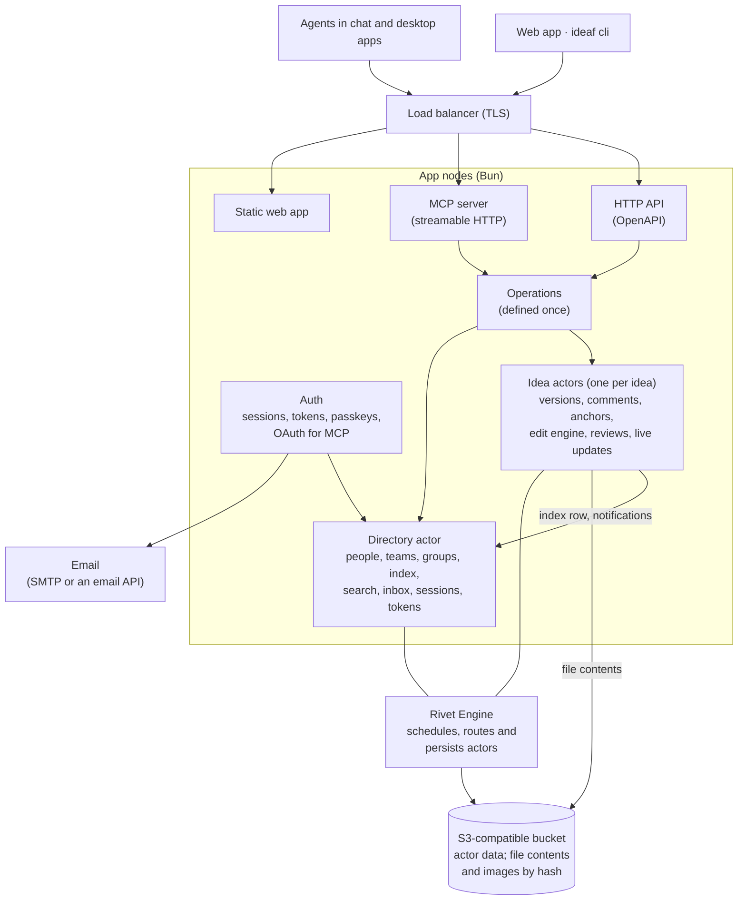
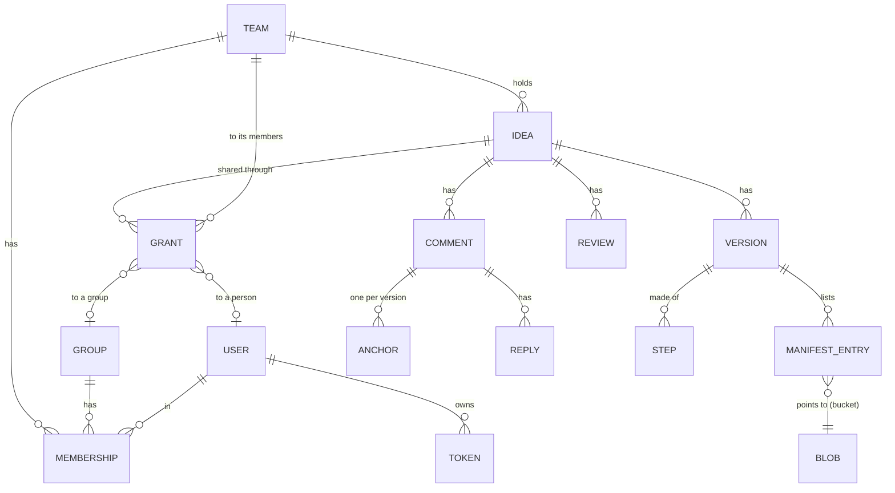
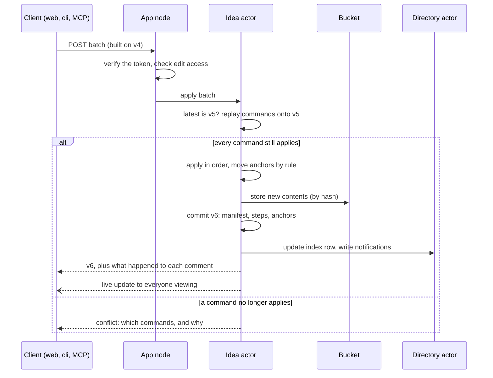
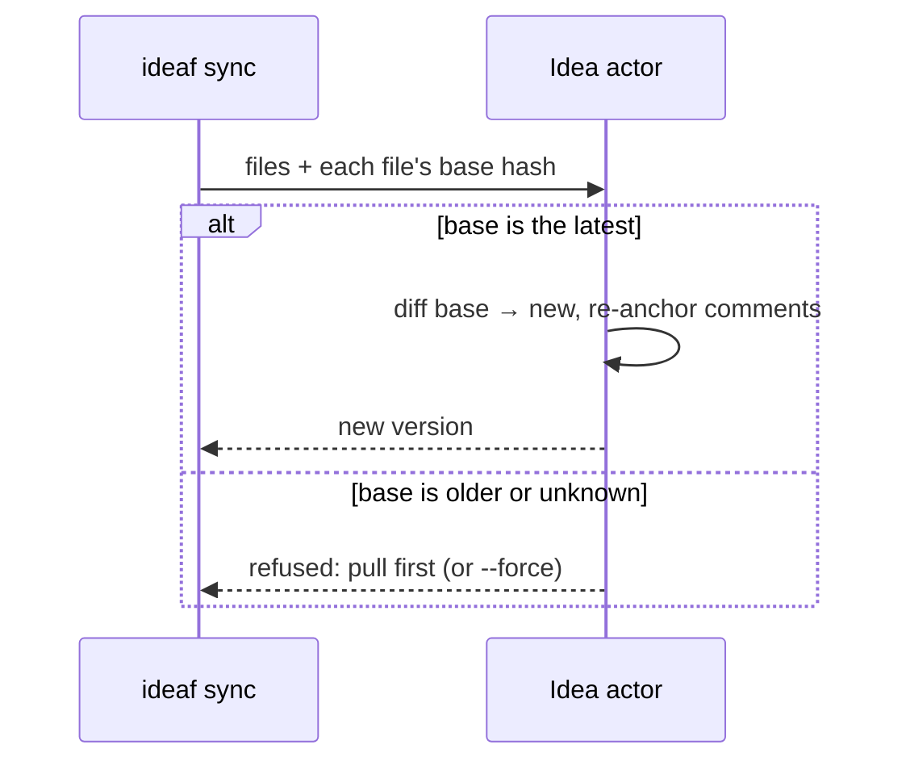

# Ideation Factory MVP: backend

**Status:** proposal for the MVP. See the [overview](architecture.md) first. The full design behind each section is in the root `architecture.md`. Open platform questions are in the [Rivet spike](spike-rivet.md) and the [Better Auth spike](spike-better-auth.md).

## Goals

- **Never lose or misplace a comment.** If we can't be sure where a comment belongs, we say so ("outdated"), never guess.
- **One consistent home per idea,** so concurrent comments, edits and approvals can't trample each other.
- **Work at organization scale:** about 10,000 people, 1,000 teams and 100,000 ideas, with bots producing most of the traffic.
- **Run on infrastructure companies already have:** containers on VMs or Kubernetes, plus an S3-compatible bucket. No particular cloud, and no database server to run.

## Components



| Part | Holds | Why there |
|---|---|---|
| **App nodes** | A Bun process on each node: routing, authentication, the operations, the HTTP API and the MCP server, serving the web app, and hosting actors | Stateless apart from the actors they host; add nodes to scale out |
| **Idea actor** | Everything about one idea, in the actor's own SQLite: versions (manifests), comments and replies, anchors for each version, suggestions, reviews and approvals, the edit-command engine, re-anchoring, live updates (actor connections and broadcasts) | All writes to an idea go through the actor's queue, one at a time, with strong consistency, so no locks; reads are parallel actions |
| **Directory actor** | People, teams, groups, memberships and roles, watch levels, sessions and tokens, an index row per idea, full-text search, notifications. One SQLite database, like a small shared database | Lists, filters and search across ideas never have to wake idea actors |
| **Rivet Engine** | Coordinates actors: where each runs, routing calls to it, persisting its data, and moving it if a node fails | One binary; one instance to start, three or more in production |
| **Bucket** | The durable copy of every actor's data (through the engine), plus file contents and images keyed by a hash of the content | Every company has one; unchanged files cost nothing in a new version |
| **Background work** | Notifying team watchers, re-checking approval rules after group changes, deleting unused content | Actor scheduling (an actor can wake itself later), off the request path |

## One set of operations: API and MCP

Every operation (list ideas, read the structured view, comment, suggest, review, dry run, apply a batch, …) is **defined once**, with a schema for its input and output. From that one definition come:

- **the HTTP route,** with its OpenAPI description;
- **the MCP tool,** with name, description and input schema;
- **a typed client** that the web app and the cli both import (everything is TypeScript, so there's no code generation step for our own clients). The OpenAPI description is still published for anyone writing another one.

**How it's built** (step 3, `packages/api`): `defineOperation` gives each operation a name, an HTTP method and path, input and output schemas (zod), and whether it reads or writes. `createRouter` serves them on the server (route matching, input from path, query and body, validation, errors as status codes); the server's handlers are typed by the output schemas, so a response that drifts from what's published doesn't compile, and tests also check every response at run time. `createApiClient` is the typed client: input is validated locally, every write gets an idempotency key (the `Idempotency-Key` header), and retries after a network error or timeout reuse it. `openApiDocument` and `mcpTools` describe the same definitions. Creating an idea takes its ID from the caller and the idempotency key, so a retried create finds the same idea.

MCP tools call the same handlers as the API, not the API over the network. So they get the same validation, visibility checks, rate limits and edit engine, with nothing to drift. Logic with meaning (edit commands, conflicts, re-anchoring, approval rules) only runs on the server. The cli sends batches and shows results.

**The hosted MCP server** uses MCP's streamable HTTP transport. People connect an agent app once and sign in with **OAuth 2.1** (what the MCP spec uses for remote servers). The consent screen is where they choose the token's purpose ("me", "a bot for me" with its name, or "a bot"), so MCP activity is attributed like everything else. MCP can review, comment and edit remotely, but it can't reach anyone's files; results get into a repository through `ideaf pull`, or an agent with file tools writing what MCP returns.

## Data model



- **In the directory actor's SQLite:** users, teams, groups, memberships, tokens, sessions, the idea index, **access grants** (idea, who: a person, a group, a team's members or everyone, and the permission: view, edit or share), search, notifications.
- **In each idea actor's SQLite:** versions, manifest entries, steps, comments, anchors, replies, suggestions, reviews.
- **In the bucket, directly:** blobs (file contents and images).

A **version** is a manifest (path → content hash, plus a stable file ID) and its **steps**: either the edit commands that made it, or "uploaded". Each **comment** has an **anchor for every version** it's in, so older versions show comments where they were then.

## Inside an idea actor

Built in step 2 (`packages/server/src/idea/`). The logic is a plain `IdeaService`; the actor is a thin shell around it.

- **Tables** (the actor's SQLite): `idea` (title, owner, status, latest version), `versions` (parent, who made it, how: created, commands or upload), `version_files` (the manifest: file ID, path, content hash, size, unit IDs), `steps` (each command of a batch and the comments it addresses), `comments` (threads and replies), `anchors` (one per comment per version, with its state), and `writes` (recent results by idempotency key). File contents are in the file store (the bucket in production) by hash, stored before the version that points at them is committed.
- **Writes** (create, comment, reply, resolve, edit, upload) go through the actor's queue, so they're applied one at a time, in order. Each carries an **idempotency key** and its result is kept for 7 days: a queued message is removed when the actor receives it, not when it completes, so a write that fails midway isn't redelivered, and the client's retry with the same key returns the first result instead of applying twice.
- **Reads** (summary, files, outline, comments as of any version, steps, a batch's dry run) are actions and run in parallel against the latest committed state. Comments made on the latest version only; each version keeps its own anchors, so older versions show comments where they were then, and an outdated comment knows the last version it applied to.
- **core runs in a pool of worker threads**, and each idea always goes to the same worker, whose parse cache then holds that idea's latest version. Measured on the large idea (890 KB): an upload stalled the main thread for 901 ms in process, and at most 2 ms through the pool. The latest version's sources and open comments are also kept in the actor's memory.
- **Size limits** are checked before parsing for uploads and new ideas, and on the result for batches (see Deployment settings in the [overview](../architecture.md)).
- **Live updates:** after each write the actor broadcasts `version`, `comment`, `reply` or `resolved` to everyone connected; a comment or reply carries itself, as `list_comments` shows it. Browsers can't reach actors, so an app node relays: a WebSocket at `/api/ideas/{idea}/live` takes a token first, checks it and the person's access as a request would be checked, then connects to the actor and passes its events on. A token counts there for 15 minutes at most, so the client sends a fresh one before then; a revoked token or an inactive account stops within that window, as for reads.

## Inside the directory actor

Built in step 5 (`packages/server/src/directory/`): a `Directory` interface, `SqlDirectory` on Kysely implementing it, and the directory actor as a thin shell (one per deployment).

- **Tables:** users, teams and groups (each with a unique handle), memberships with roles, join requests, the idea index (title, team, owner, status, latest version, updated time), and access grants (idea, who: a person, a group, a team's members or everyone, and whether they can edit and share; a row always gives view).
- **Reads and writes are actions.** Writes stay correct when they run at once through keys, upserts and transactions, not the actor's queue order, which is what the Postgres version needs too. A contract test suite covers the interface, for every implementation.
- **Index updates come through the queue:** after a write, an idea actor schedules one update of its index row about 2 seconds later, however many writes happen meanwhile, and sends it without waiting. The directory applies them in batches, keeping only the newest per idea, and never moves a row's updated time backwards.
- **Access:** the app node checks the caller's permission on an idea in the directory before every idea operation (one indexed read). An idea you can't view is "not found". Lists and search filter by access inside their own indexed query.
- **Search:** FTS5 with the trigram tokenizer (confirmed in RivetKit's SQLite), behind its own interface. A search needs at least 3 characters (shorter words in it are ignored), so nothing is a full scan. Access and ranking are applied in the search query itself, before the limit, so ideas you can't see never crowd out yours; ranking is by closeness (exact title, starts with, a word starts with, anywhere), then most recently updated, in SQL that works on Postgres too. **A work cap** like Elasticsearch's `terminate_after`: one search reads at most 20,000 matches (the most recently updated), and says `incomplete` if there were more, so a very common word can't stall the directory. At 100,000 ideas: about 14 ms for a word in 10% of titles, about 24 ms for a word in every title.
- **Accounts** are Better Auth's own tables in the same actor (see Auth and access). The directory keeps its `users` table, filled in from Better Auth's hooks when an account is created or changes, rather than pointing Better Auth at it: Better Auth stores dates as strings and adds columns of its own, and the directory's queries stay the same either way.

## Schema changes

**During the alpha there are no migrations** (see `AGENTS.md`): a schema change edits v1 in place and re-freezes it, and local data is thrown away. What follows is the process for once something ships.

There's one directory database and a separate SQLite database inside every idea actor, so a schema change reaches thousands of small databases, not one.

- **Migrations are numbered lists in code** (`idea/schema.ts`, `directory/schema.ts`), with a `schema_version` table in each database. They only go forward: a change is a new migration appended to the list, and a migration that has shipped is never edited.
- **They run on wake.** RivetKit runs `onMigrate` when an actor starts, before it serves anything, inside a savepoint, so a migration applies completely or not at all, and a running actor is always on the current schema. Migrations don't open transactions of their own.
- **Expand, then contract.** A rolling deploy moves actors to new nodes gradually, so old app nodes call actors that already have the new schema. A change first adds what it needs (a nullable or defaulted column, a table, an index) in a way the old code ignores; a later release removes the old shape once nothing uses it. That also keeps rolling a deploy back safe.
- **Idea actors migrate lazily,** each when it next wakes, so there's no single big run, but the migration sits on that first request. Keep per-idea migrations small. For heavy data changes, a background sweep walks the idea index and wakes each idea at a controlled rate, so the work happens before people open them; the migration code is the same either way.
- **The directory** is one actor: its migration runs once, when it moves to the new version, on everyone's path, so the same care applies.
- **Stored JSON** (anchors, batch steps) carries its own version and is read as it was written, converted when needed, never rewritten in bulk. File contents are stored by hash and never change, so they never migrate.
- **Postgres,** if the directory moves there: the migrations are written with Kysely's schema builder, which gives the Postgres DDL too (search has its own). There, migrations run once at deploy time under a lock (Kysely's `Migrator`), because several app nodes could otherwise start them at once.

**Tests** (`packages/server/src/migrations/`): every schema version is frozen as the SQL an existing database has at that version (`frozen/<schema>-v<N>.sql`, written once by `freeze.ts` and never changed). The tests check that upgrading from each frozen version gives exactly the schema a fresh database gets, which fails if a shipped migration was edited instead of a new one appended; that every version is frozen; that migrating again changes nothing; and that data written at an older version reads back through the real service afterwards. Adding a migration means appending it, running `bun packages/server/src/migrations/freeze.ts`, and adding a data test for it.

**Each actor's types match its schema:** both actors' queries are written with Kysely against a `DB` interface (`IdeaDB` in `idea/schema.ts`, `DB` in `directory/schema.ts`). A column list next to each (`IDEA_COLUMNS`, `COLUMNS`) is tied to the interface by a type check, and a test compares it with a freshly migrated database, so a column added to the types without a migration (or by a migration without the types) fails typecheck or CI. The idea actor's v1 migration stays the raw SQL it shipped as; later migrations use Kysely's schema builder.

## Editing with commands

The core of the product. The web app, the cli, the MCP server and "accept suggestion" all send **batches of edit commands** to the idea's actor:

| Command | Effect on comments |
|---|---|
| `replace` {scope, old, new}: `old` must match exactly once | Comments on that text cover the new text, marked *changed* |
| `insert` | None |
| `delete` | Its comments become *outdated* |
| `move` (also to another file) | Comments move with it, even if a later command edits it |
| `rename-heading` | Section comments stay |
| `set-section` | Section comments stay; text comments that lose their text become *outdated* |
| `rename-file`, `create-file`, `delete-file` | Comments follow the file, or become *outdated* |



- **A dry run** returns the same result without committing, so you can preview first.
- **A batch is all or nothing**, and makes one version.
- **Concurrency works like a pull request:** a batch built on an older version merges if it still applies, and conflicts otherwise. Nothing is merged by guesswork.

## Uploading an edited copy

`ideaf sync` can still upload whole files. Each file says which content it was edited from (its **base** hash):



Re-anchoring an upload uses only exact steps, in order:
1. Follow each comment's position through the diff.
2. Find blocks that moved without changing (by exact hash), even into another file.
3. Recognize headings renamed in place.

Anything else becomes **outdated** and links to the last version where it applied. There's no fuzzy matching in the MVP.

## Auth and access

- **Handles change:** a person's (in their settings) or a team's (by its admins). The old handle keeps leading to them, their page and their ideas' addresses included, through the directory's handle aliases. For 90 days it's **parked**: nobody else can sign up with it, rename to it or be told it's free, so links and mentions can't start leading to someone new, and only its owner can take it back. After that it's free again, and leads to them until someone else takes it. A site admin can release a squatted or parked handle sooner (`admin.ts release-handle`): its holder, if any, gets a generated one and the old one leads nowhere, which breaks links through it, so it's an admin's decision. A handle suggested at single sign-on passes over parked ones.
- **Sign-in:** a one-time code sent to the account's primary email, or a passkey (WebAuthn). There are no passwords. A passkey can only be added right after signing in with a code. Or, for most deployments, the organization's identity provider (single sign-on, below).
- **Sessions:** a `HttpOnly`, `Secure`, `SameSite` cookie, backed by a session row in the directory actor.
- **Tokens** for the cli and agents: each has a purpose ("me", "a bot for me", "a bot") that decides how its activity is labeled. Only a hash is stored; a token expires within a year; tokens never carry site admin powers.
- **MCP clients** sign in with OAuth 2.1 and get a token with a purpose chosen on the consent screen.
- **The library:** [Better Auth](https://better-auth.com) 1.7.14, chosen in the [Better Auth spike](spike-better-auth.md). It runs **inside the directory actor** (the spike's approach 2), on its own Kysely SQLite adapter over the actor's database (`auth/dialect.ts`, with real transactions), and its tables are made by its own migrations when the actor starts. App nodes forward `/api/auth/*` to the actor as an action.
- **Built so far (step 6, parts 1 to 3):** email codes (sent over SMTP, or written to the server log in development), handles, sessions, passkeys (only right after an email code), inactive accounts (no new tokens, writes refused at once), and Better Auth as the **OAuth authorization server**. The cli (`ideaf-cli`, a public client, made when the directory actor wakes) signs in with the authorization code flow and PKCE, redirecting to a loopback port or to `/cli/code`, a page that shows the code to paste. Access tokens are 15-minute EdDSA JWTs for the API (its one resource, so never opaque), checked on every request by signature alone, with the public keys cached on each app node for 5 minutes; refresh tokens rotate. Single sign-on and SCIM (below). The code is in `packages/server/src/auth/`. **Still to come:** MCP clients (CIMD), which reuse the same consent page and token grants.
- **Token grants** narrow what a token can do. On the consent page (`/consent`) a person chooses who acts with the token (themselves, a bot for them, a bot), read only or not, and its reach: everything they can see, or only some teams, ideas, or ideas outside teams. That's recorded as a token grant in the directory (`token_grants`, `token_grant_targets`), kept as the OAuth consent's reference, and turned into every access token's claims, refreshes included: the grant's ID (`gid`), read only (`ro`) and limited (`lim`). An app node refuses a read-only token's writes, and a limited token's sharing, moving or team changes, without asking the directory; the directory narrows which ideas it reaches inside the permission check and the list and search queries that already run. A token never does more than its owner can, and revoking its grant (`POST /token/revoke`, which `ideaf auth logout` calls) stops it at once and makes its refreshes fail. Personal tokens can name a grant too.
- **Single sign-on:** one identity provider for the whole deployment, OIDC or SAML 2.0, through Better Auth's `sso` plugin, set in environment variables for now (`IDEAF_SSO` and the rest, in `auth/settings.ts` and the README) and read on every request, so a site admin page can change them later without a restart. The provider is never registered at runtime, so its secrets and our SAML key stay out of the database. Who gets in is decided by our `resolveUser` hook, inside the sign-in's transaction: a provider identity seen before reaches its account (and the primary email follows the provider's, unless another account has it); otherwise the account with that email, so switching a deployment keeps everyone's ideas and tokens; otherwise a new account if `IDEAF_SSO_AUTO_CREATE` is on. Emails outside `IDEAF_SSO_DOMAINS` and inactive accounts are refused. **Matching on email trusts the provider's emails:** we don't require its `email_verified` claim (SAML providers rarely send one), so the deployment's provider must not let people set their own email, or someone could set a colleague's and reach their account. Company providers set emails from their directory. Requiring the claim could become a setting, for providers that send it. A new account gets a handle suggested from the email (`jane.doe@` → `jane-doe`, `-2` if taken) that its person keeps or changes once, on the sign-in or consent page (`/ideaf/confirm-handle`). While it's on, email codes and passkeys are refused, except an email code for site admins (the way in when the provider is down). For `ideaf auth login`, the sign-in page sends the browser back to the authorize request afterwards, since Better Auth doesn't carry an OAuth sign-in through single sign-on. SAML responses must be signed, and are checked against the request they answer (no replays).
- **SCIM**, people only: with `IDEAF_SCIM_TOKEN`, the provider's SCIM client (`/api/auth/scim/v2/Users`, through Better Auth's `scim` plugin) makes accounts ahead of the first sign-in, links someone who already has an account by email, and keeps names and emails in step. Deactivating someone there marks them inactive here, deletes their sessions and stops their writes at once; reactivating lets them back. The token only grants the user scopes, so the provider's groups aren't taken. Changes SCIM and single sign-on make straight in Better Auth's tables reach the directory's `users` once their transaction commits.
- **Personal tokens are a stopgap for CI,** where nobody can sign in: people and agents use OAuth, and workload identity (OIDC from the CI provider) may replace them later. A personal token goes in requests as is and is **checked in the directory on every request**, which is acceptable for a CI job's handful of calls. `IDEAF_PERSONAL_TOKENS` decides who may make and use them: everyone, site admins only (the default), or no one. Turning them off refuses existing ones too. Site admin tokens (at most 30 days, with a reason) are separate.

### Checking who's calling, without a database read

Sessions and tokens are long-lived, and they live in the directory actor. Reading it on every request would put that one actor on every request's path (see below). So **requests carry a short-lived signed access token** instead:

- **15 minutes.** That's on the short side of common practice (about an hour is a typical default; 5 to 15 minutes is the security-minded range), because the cost of refreshing is tiny and revocation matters to us.
- **Checking one is a signature verification,** a few microseconds of CPU, on any node, with no actor call.
- **What's in it:** who the caller is (user ID), the token's purpose and bot name, a token ID, the issuer and audience, and the expiry. **Nothing about roles, teams or groups.** Authorization always uses current data, so removing someone from a team still takes effect at once.
- **Where long-lived credentials are checked:** only when a short-lived token is issued or refreshed. A browser refreshes through its session; the cli exchanges its personal token; MCP clients use OAuth refresh tokens. That's one directory read per client every 15 minutes, about 11 a second for 10,000 active clients, instead of one per request.
- **Clients that send a personal token on every request** (a quick curl script, say) still work, on a slower path that checks the directory each time.
- **Signing keys:** Ed25519, made by Better Auth's `jwt` plugin and kept in the directory (its `jwks` table), the private key encrypted with `IDEAF_AUTH_SECRET`, so there's one secret to manage rather than a key file. Each token names its key by ID. A key signs for 30 days, then the next token gets a new one; a replaced key stays published for a day, well past the tokens it signed, so a rotation never fails a request. App nodes cache the published keys for a minute, and fetch them at once for a key ID they haven't seen. `bun packages/server/src/admin.ts rotate-signing-key` replaces the key now. Validation is strict: a fixed algorithm list (never `none`), plus expiry, issuer and audience checks.

**Revocation takes effect within 15 minutes.** Revoking a token, signing a session out, or marking a user inactive stops new short-lived tokens straight away, and any already issued expire within 15 minutes. That applies to site admin tokens too. **Writes don't wait:** a write checks the caller's current status, so an inactive user's writes are refused at once; only reads ride out the window. **Emergency:** `rotate-signing-key --emergency` withdraws every signing key, so every outstanding short-lived token stops working within a minute (the app nodes' key cache), and clients refresh with their sessions or refresh tokens, which aren't affected.

### CIMD

**Client ID Metadata Documents (CIMD)** are the current MCP standard for a client to identify itself (the 2026-07-28 MCP spec recommends them and deprecates Dynamic Client Registration). The client's ID is a URL, and the server fetches a metadata document from it, so the fetch must never reach a private network (SSRF protection). On our own servers that's solvable properly: resolve the hostname once, refuse any private or special-use address, pin the connection to the approved address, and refuse redirects. Better Auth ships exactly that transport for Node (it pins through `node:https`'s `lookup` option). Bun's `node:https` client has been built on `node:net`, which honors `lookup`, since mid-2026, so it should work. **To confirm in the spike,** including a hostname that resolves to a private address. As a backstop, Better Auth can limit CIMD to an allowlist of client hosts.

- **Access is per idea** (view, edit, share; see Authorization in the [overview](../architecture.md)). Grants are rows in the directory actor, to a person, a group, a team's members or everyone, and access through a group or team follows membership. Reviewers are viewers: asking for a review adds a view grant.
- **Access is checked on every read,** in lists, search, counts, the API, MCP, the cli and notifications. Lists and search filter in the indexed query: ideas that are public, or have a grant to the caller, to a group they're in, or to a team they're in. Inside an idea, its actor keeps its own grants and the member lists they depend on cached (see [scale concerns](scale-concerns.md) concern 2).
- **Editing** is for the idea's owner, people with edit access, and bots acting for them. Reviewers propose changes as suggested edits.
- **Rate limits** are per token, stricter for bots, with a per-idea cap on comments per minute. Counters live in actors, never in the directory (see [scale concerns](scale-concerns.md)). Sign-in's own limits (Better Auth's, on sending codes and signing in) count per client address. Better Auth runs in the directory actor and never sees who connected, so the app node works out the address and passes it on in a header of its own (`x-ideaf-client-ip`, a client's copy dropped): whoever connected, unless that's one of `IDEAF_TRUSTED_PROXIES`, when it's the first address in `X-Forwarded-For` from the right that isn't a proxy. Anyone else's `X-Forwarded-For` is ignored, so a client can't make up an address to dodge its limit, or share everyone's.

## Notifications and search

- **Direct participants** (the owner, reviewers, members of reviewer groups, followers) get an inbox row when something happens.
- **Team watchers aren't written one by one:** a team's activity is merged into a watcher's inbox when they read it. Busy teams stay cheap.
- **The inbox is bundled per idea when read,** like GitHub's: one row per idea, however many events.
- **Search** uses SQLite full-text search (FTS5 with a trigram index) in the directory actor. It finds text anywhere in a word, ranked by the field it's in and how close the match is. FTS5 is available in actor SQLite (a crash on closing FTS5 connections was fixed in Rivet 3.0 preview 3); the spike confirms the trigram tokenizer.

## Self-hosting

**It runs on infrastructure companies already have.** No particular cloud, and no database server:

- **App nodes:** our Bun app, as a container.
- **The Rivet Engine (3.0):** one Rust binary, as a container, with a local disk per instance. Bucket-only storage needs 3.0, which is in preview; see the [Rivet spike](spike-rivet.md) for the fallback.
- **A bucket:** S3-compatible object storage **with conditional writes** (`If-Match` / `If-None-Match` on PUT), which the Rivet Engine uses for leases and manifests. The major clouds' storage has them (AWS S3, Google Cloud Storage, Azure Blob, Cloudflare R2). On-premises: SeaweedFS or RustFS (both Apache-2.0, both implement them); to be proven in the [Rivet spike](spike-rivet.md). Garage doesn't support them, and MinIO's open-source repository is archived. The bucket holds every actor's durable data and the file contents.
- **A load balancer** in front of the app nodes, for TLS: nginx, HAProxy, Caddy or the cloud's own.
- **Email:** SMTP, or an email provider's API.

Rivet's hosted engine (Rivet Cloud) is an option for teams that don't want to run the engine, never a requirement.

### Two shapes

**Small: one VM.**

```
VM:  nginx (TLS) ──> app (Bun + RivetKit) ──> Rivet Engine (1 instance, local disk)
                                                 └──> bucket (outside the VM)
```

Simple, with stated trade-offs: no failover (if the VM is down, the app is down), a short window where the latest writes exist only on the VM's disk before reaching the bucket (about a minute with default settings, to be measured), and a brief outage during upgrades.

**Production: three VMs (or Kubernetes), ideally in different zones.**

```
                 load balancer (nginx/HAProxy, or the cloud's)
                 /                |                \
VM 1: app + engine      VM 2: app + engine      VM 3: app + engine
             \________ private network (engines talk on 6421) ________/
                                  |
                       bucket (outside every VM)
```

- Each VM runs one engine instance with its own disk, and one app node. A write is acknowledged once **a majority of instances** have it on disk, then moved to the bucket. If a node fails, Rivet notices within 40 seconds and restarts its actors elsewhere with their state intact, so losing one of three loses nothing, but its actors are unavailable for up to about a minute.
- **Round-robin load balancing is fine:** no sticky sessions, because the engine routes each actor call to wherever that actor runs.
- App nodes reach the engines on port 6420. Port 6421 stays on the private network. Only the app port is exposed.

The same code runs in both shapes, so a team can start on one VM and grow to three without changes. Three instances on **one** VM isn't a production setup: they'd share a machine and a disk, which is exactly what the three are meant to survive.

### What stays behind interfaces

Only two things are platform-specific, and both sit behind small interfaces:

| Interface | Implementation |
|---|---|
| Files | The S3 API (Bun has a built-in S3 client), against whichever bucket the deployment provides |
| Email (sign-in codes) | SMTP, or an email provider's API |

### The directory actor is the one shared owner

Each idea actor runs in one place and applies its writes one at a time. That's the point of the design, and there are many idea actors, spread across the nodes. The **directory actor** is different: there's exactly one, so everything shared goes through it.

- **What hits it:** list, search, inbox and directory queries; issuing and refreshing short-lived tokens; and the index rows and notifications that idea actors write after each change.
- **The risk:** it's one SQLite database, on one node, applying its writes one at a time. Indexed reads are fast, so it should cope at our design scale, but it's one shared dependency. If its node fails, everything that needs it waits until the engine moves it.
- **Calls hop to it:** most requests land on a node that isn't hosting the directory actor, so the call crosses the private network. That's small, but it's on most list and search requests.

**Mitigations, in order of effort:**
1. **15-minute signed tokens** keep it off the authentication path (above).
2. **Keep the per-idea split strict:** anything about one idea is served by its idea actor, never by the directory.
3. **Coalesce writes:** idea actors update their index row at most every few seconds, and write inbox rows in one statement per event.
4. **Measure it** in the Rivet spike, then the load test.
5. **Only if needed, split it:** an actor per person (inbox, watch settings) and per team (members, the team's idea list), leaving the directory actor with search and type-ahead. That's the escape hatch, not the starting point.

**Postgres is the other escape hatch.** Everything stays in Rivet by default. For a customer who'd rather run Postgres, the directory can be swapped for it, removing the single owner: every app node queries it directly, writes run in parallel, and availability comes from their managed Postgres. Idea actors stay on Rivet either way. To keep that cheap, the MVP builds the directory so the swap is an added implementation, not a redesign:

- **One `Directory` interface** in the server (members, teams, groups, index rows, inbox, tokens, search). The actor is the only implementation at first; config picks it (`directory: actor`, later `postgres`).
- **SQL that works in both:** through Kysely, which targets SQLite and Postgres (chosen in step 5; its table types aren't tied to one database, unlike Drizzle's). It runs on the actor's SQLite through a small adapter; the schema is defined with its schema builder.
- **Search behind its own interface,** since it's what differs most (FTS5 with trigrams vs. `pg_trgm`). Ranking stays in our code.
- **Correct under concurrency:** unique constraints, upserts and transactions, never relying on the actor's queue order. The Postgres version runs writes concurrently.
- **One test suite** for the interface, run against every implementation in CI once there's a second.

## Scale

The open performance risks (directory writes under bot bursts, access checks on every read, rate limiting, heavy work inside an idea, and more), with mitigations and a load-test plan, are in [scale concerns](scale-concerns.md).

## After the MVP

- Single sign-on (SAML/OIDC) with automatic account creation, and SCIM deprovisioning.
- Inactive users, permanent team deletion, and site admin tokens.
- Review batching (one submission instead of many comments).
- Email notifications.
- Fuzzy re-anchoring, once it can be measured on real edit histories.
- A Helm chart for Kubernetes, beyond the MVP's example manifests.
