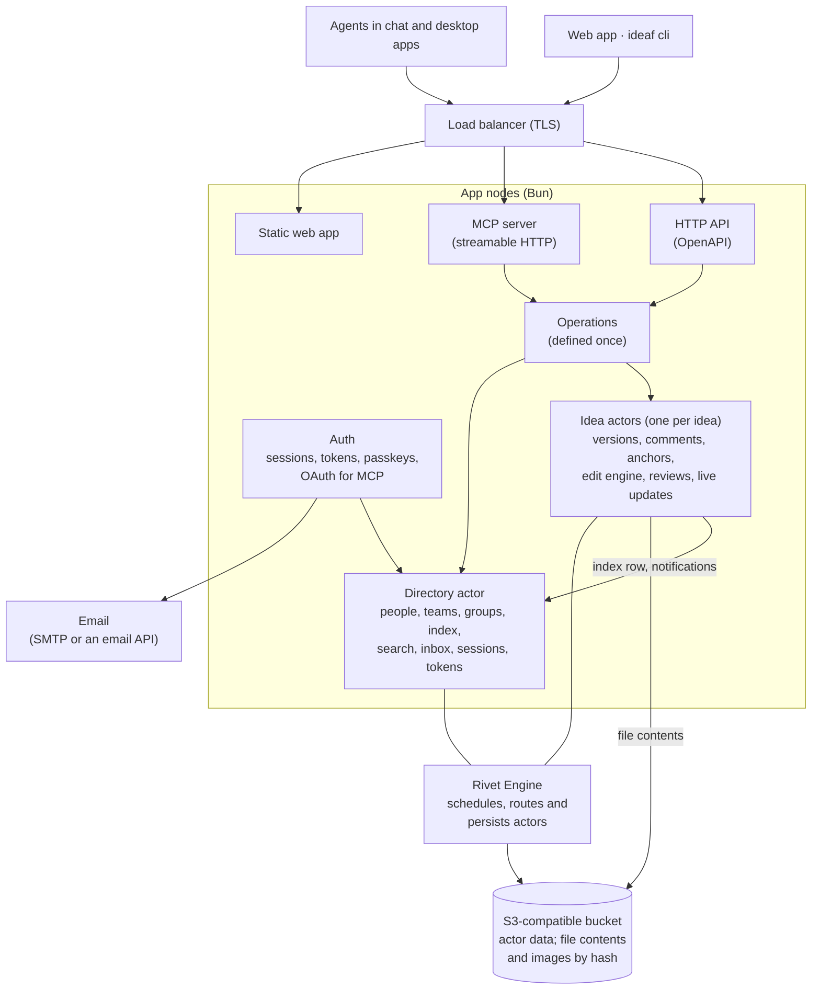
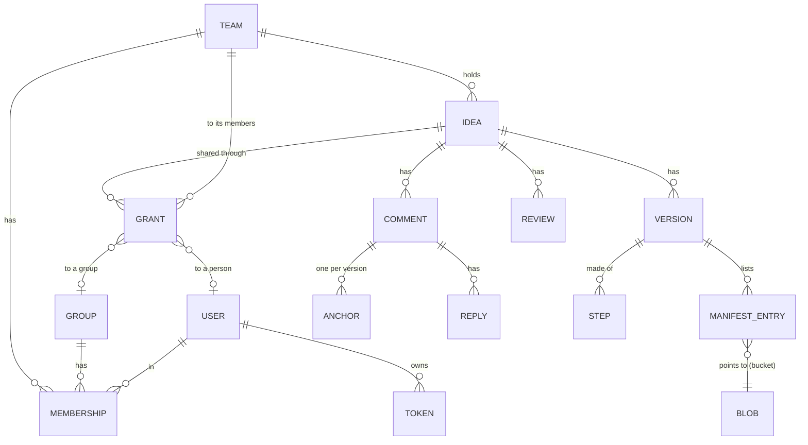
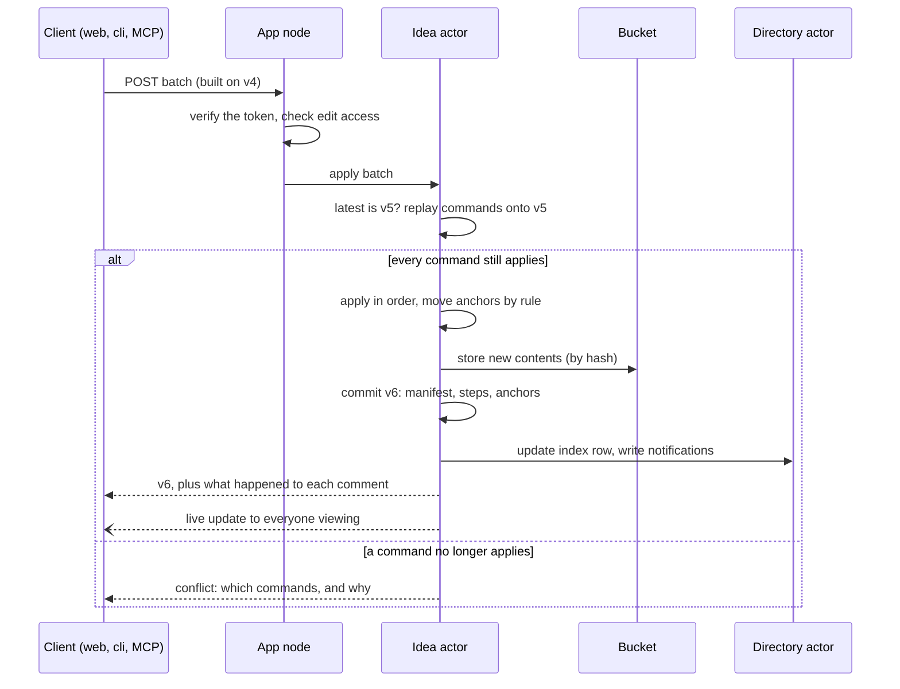
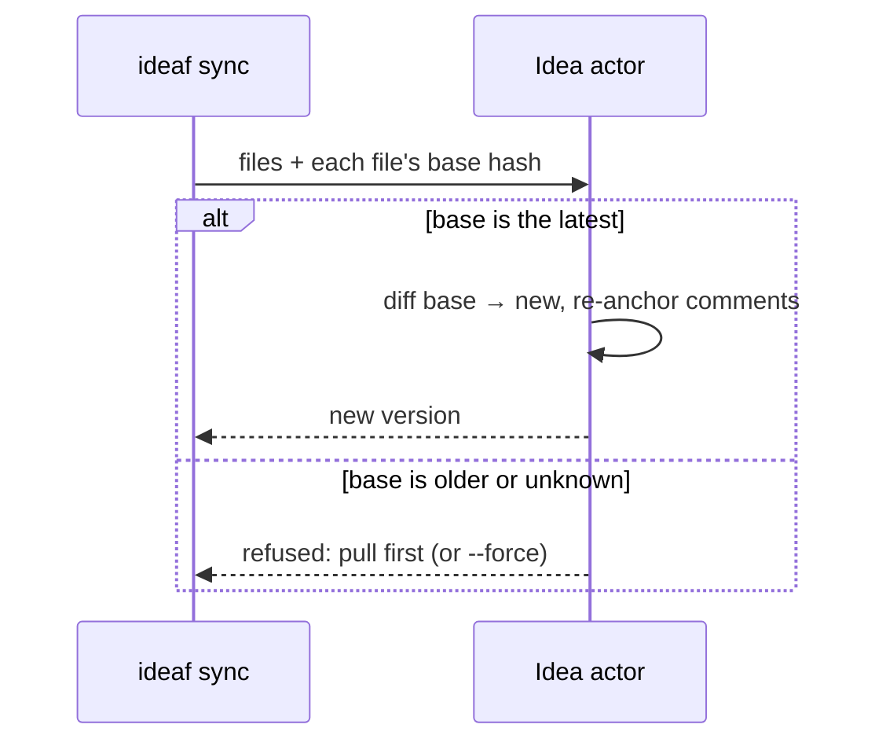

# Ideation Factory MVP: backend

**Status:** proposal for the MVP. See the [overview](architecture.md) first. The full design behind each section is in the root `architecture.md`. Open platform questions are in the [Rivet spike](spike-rivet.md) and the [Better Auth spike](spike-better-auth.md).

## Goals

- **Never lose or misplace a comment.** If we can't be sure where a comment belongs, we say so ("outdated"), never guess.
- **One consistent home per idea,** so concurrent comments, edits and approvals can't trample each other.
- **Work at organization scale:** about 10,000 people, 1,000 teams and 100,000 ideas, with bots producing most of the traffic.
- **Run on infrastructure companies already have:** containers on VMs or Kubernetes, plus an S3-compatible bucket. No particular cloud, and no database server to run.

## Components



| Part | Holds | Why there |
|---|---|---|
| **App nodes** | A Bun process on each node: routing, authentication, the operations, the HTTP API and the MCP server, serving the web app, and hosting actors | Stateless apart from the actors they host; add nodes to scale out |
| **Idea actor** | Everything about one idea, in the actor's own SQLite: versions (manifests), comments and replies, anchors for each version, suggestions, reviews and approvals, the edit-command engine, re-anchoring, live updates (actor connections and broadcasts) | All writes to an idea go through the actor's queue, one at a time, with strong consistency, so no locks; reads are parallel actions |
| **Directory actor** | People, teams, groups, memberships and roles, watch levels, sessions and tokens, an index row per idea, full-text search, notifications. One SQLite database, like a small shared database | Lists, filters and search across ideas never have to wake idea actors |
| **Rivet Engine** | Coordinates actors: where each runs, routing calls to it, persisting its data, and moving it if a node fails | One binary; one instance to start, three or more in production |
| **Bucket** | The durable copy of every actor's data (through the engine), plus file contents and images keyed by a hash of the content | Every company has one; unchanged files cost nothing in a new version |
| **Background work** | Notifying team watchers, re-checking approval rules after group changes, deleting unused content | Actor scheduling (an actor can wake itself later), off the request path |

## One set of operations: API and MCP

Every operation (list ideas, read the structured view, comment, suggest, review, dry run, apply a batch, …) is **defined once**, with a schema for its input and output. From that one definition come:

- **the HTTP route,** with its OpenAPI description;
- **the MCP tool,** with name, description and input schema;
- **a typed client** that the web app and the cli both import (everything is TypeScript, so there's no code generation step for our own clients). The OpenAPI description is still published for anyone writing another one.

MCP tools call the same handlers as the API, not the API over the network. So they get the same validation, visibility checks, rate limits and edit engine, with nothing to drift. Logic with meaning (edit commands, conflicts, re-anchoring, approval rules) only runs on the server. The cli sends batches and shows results.

**The hosted MCP server** uses MCP's streamable HTTP transport. People connect an agent app once and sign in with **OAuth 2.1** (what the MCP spec uses for remote servers). The consent screen is where they choose the token's purpose ("me", "a bot for me" with its name, or "a bot"), so MCP activity is attributed like everything else. MCP can review, comment and edit remotely, but it can't reach anyone's files; results get into a repository through `ideaf pull`, or an agent with file tools writing what MCP returns.

## Data model



- **In the directory actor's SQLite:** users, teams, groups, memberships, tokens, sessions, the idea index, **access grants** (idea, who: a person, a group, a team's members or everyone, and the permission: view, edit or share), search, notifications.
- **In each idea actor's SQLite:** versions, manifest entries, steps, comments, anchors, replies, suggestions, reviews.
- **In the bucket, directly:** blobs (file contents and images).

A **version** is a manifest (path → content hash, plus a stable file ID) and its **steps**: either the edit commands that made it, or "uploaded". Each **comment** has an **anchor for every version** it's in, so older versions show comments where they were then.

## Inside an idea actor

Built in step 2 (`packages/server/src/idea/`). The logic is a plain `IdeaService`; the actor is a thin shell around it.

- **Tables** (the actor's SQLite): `idea` (title, owner, status, latest version), `versions` (parent, who made it, how: created, commands or upload), `version_files` (the manifest: file ID, path, content hash, size, unit IDs), `steps` (each command of a batch and the comments it addresses), `comments` (threads and replies), `anchors` (one per comment per version, with its state), and `writes` (recent results by idempotency key). File contents are in the file store (the bucket in production) by hash, stored before the version that points at them is committed.
- **Writes** (create, comment, reply, resolve, edit, upload) go through the actor's queue, so they're applied one at a time, in order. Each carries an **idempotency key** and its result is kept for 7 days: a queued message is removed when the actor receives it, not when it completes, so a write that fails midway isn't redelivered, and the client's retry with the same key returns the first result instead of applying twice.
- **Reads** (summary, files, outline, comments as of any version, steps, a batch's dry run) are actions and run in parallel against the latest committed state. Comments made on the latest version only; each version keeps its own anchors, so older versions show comments where they were then, and an outdated comment knows the last version it applied to.
- **core runs in a pool of worker threads**, and each idea always goes to the same worker, whose parse cache then holds that idea's latest version. Measured on the large idea (890 KB): an upload stalled the main thread for 901 ms in process, and at most 2 ms through the pool. The latest version's sources and open comments are also kept in the actor's memory.
- **Size limits** are checked before parsing for uploads and new ideas, and on the result for batches (see Deployment settings in the [overview](../architecture.md)).
- **Live updates:** after each write the actor broadcasts `version`, `comment` or `resolved` to everyone connected.
- **Until access grants exist** (step 5), only the owner edits, and a single dev token stands in for sign-in.

## Editing with commands

The core of the product. The web app, the cli, the MCP server and "accept suggestion" all send **batches of edit commands** to the idea's actor:

| Command | Effect on comments |
|---|---|
| `replace` {scope, old, new}: `old` must match exactly once | Comments on that text cover the new text, marked *changed* |
| `insert` | None |
| `delete` | Its comments become *outdated* |
| `move` (also to another file) | Comments move with it, even if a later command edits it |
| `rename-heading` | Section comments stay |
| `set-section` | Section comments stay; text comments that lose their text become *outdated* |
| `rename-file`, `create-file`, `delete-file` | Comments follow the file, or become *outdated* |



- **A dry run** returns the same result without committing, so you can preview first.
- **A batch is all or nothing**, and makes one version.
- **Concurrency works like a pull request:** a batch built on an older version merges if it still applies, and conflicts otherwise. Nothing is merged by guesswork.

## Uploading an edited copy

`ideaf sync` can still upload whole files. Each file says which content it was edited from (its **base** hash):



Re-anchoring an upload uses only exact steps, in order:
1. Follow each comment's position through the diff.
2. Find blocks that moved without changing (by exact hash), even into another file.
3. Recognize headings renamed in place.

Anything else becomes **outdated** and links to the last version where it applied. There's no fuzzy matching in the MVP.

## Auth and access

- **Sign-in:** a one-time code sent to the account's primary email, or a passkey (WebAuthn). There are no passwords. A passkey can only be added right after signing in with a code.
- **Sessions:** a `HttpOnly`, `Secure`, `SameSite` cookie, backed by a session row in the directory actor.
- **Tokens** for the cli and agents: each has a purpose ("me", "a bot for me", "a bot") that decides how its activity is labeled. Only a hash is stored; a token expires within a year; tokens never carry site admin powers.
- **MCP clients** sign in with OAuth 2.1 and get a token with a purpose chosen on the consent screen.
- **The library:** [Better Auth](https://better-auth.com) is the candidate for all of this (email codes, passkeys, sessions, JWT signing, and the MCP authorization server). It's being evaluated in the [Better Auth spike](spike-better-auth.md), including how its storage maps onto the directory actor.

### Checking who's calling, without a database read

Sessions and tokens are long-lived, and they live in the directory actor. Reading it on every request would put that one actor on every request's path (see below). So **requests carry a short-lived signed access token** instead:

- **15 minutes.** That's on the short side of common practice (about an hour is a typical default; 5 to 15 minutes is the security-minded range), because the cost of refreshing is tiny and revocation matters to us.
- **Checking one is a signature verification,** a few microseconds of CPU, on any node, with no actor call.
- **What's in it:** who the caller is (user ID), the token's purpose and bot name, a token ID, the issuer and audience, and the expiry. **Nothing about roles, teams or groups.** Authorization always uses current data, so removing someone from a team still takes effect at once.
- **Where long-lived credentials are checked:** only when a short-lived token is issued or refreshed. A browser refreshes through its session; the cli exchanges its personal token; MCP clients use OAuth refresh tokens. That's one directory read per client every 15 minutes, about 11 a second for 10,000 active clients, instead of one per request.
- **Clients that send a personal token on every request** (a quick curl script, say) still work, on a slower path that checks the directory each time.
- **Signing keys:** Ed25519 or ES256, stored as secrets, named in each token by key ID, with two keys accepted during a rotation. Validation is strict: a fixed algorithm list (never `none`), plus expiry, issuer and audience checks.

**Revocation takes effect within 15 minutes.** Revoking a token, signing a session out, or marking a user inactive stops new short-lived tokens straight away, and any already issued expire within 15 minutes. That applies to site admin tokens too. **Writes don't wait:** a write checks the caller's current status, so an inactive user's writes are refused at once; only reads ride out the window. **Emergency:** rotating the signing key ends every outstanding short-lived token at once.

### CIMD

**Client ID Metadata Documents (CIMD)** are the current MCP standard for a client to identify itself (the 2026-07-28 MCP spec recommends them and deprecates Dynamic Client Registration). The client's ID is a URL, and the server fetches a metadata document from it, so the fetch must never reach a private network (SSRF protection). On our own servers that's solvable properly: resolve the hostname once, refuse any private or special-use address, pin the connection to the approved address, and refuse redirects. Better Auth ships exactly that transport for Node (it pins through `node:https`'s `lookup` option). Bun's `node:https` client has been built on `node:net`, which honors `lookup`, since mid-2026, so it should work. **To confirm in the spike,** including a hostname that resolves to a private address. As a backstop, Better Auth can limit CIMD to an allowlist of client hosts.

- **Access is per idea** (view, edit, share; see Authorization in the [overview](../architecture.md)). Grants are rows in the directory actor, to a person, a group, a team's members or everyone, and access through a group or team follows membership. Reviewers are viewers: asking for a review adds a view grant.
- **Access is checked on every read,** in lists, search, counts, the API, MCP, the cli and notifications. Lists and search filter in the indexed query: ideas that are public, or have a grant to the caller, to a group they're in, or to a team they're in. Inside an idea, its actor keeps its own grants and the member lists they depend on cached (see [scale concerns](scale-concerns.md) concern 2).
- **Editing** is for the idea's owner, people with edit access, and bots acting for them. Reviewers propose changes as suggested edits.
- **Rate limits** are per token, stricter for bots, with a per-idea cap on comments per minute. Counters live in actors, never in the directory (see [scale concerns](scale-concerns.md)).

## Notifications and search

- **Direct participants** (the owner, reviewers, members of reviewer groups, followers) get an inbox row when something happens.
- **Team watchers aren't written one by one:** a team's activity is merged into a watcher's inbox when they read it. Busy teams stay cheap.
- **The inbox is bundled per idea when read,** like GitHub's: one row per idea, however many events.
- **Search** uses SQLite full-text search (FTS5 with a trigram index) in the directory actor. It finds text anywhere in a word, ranked by the field it's in and how close the match is. FTS5 is available in actor SQLite (a crash on closing FTS5 connections was fixed in Rivet 3.0 preview 3); the spike confirms the trigram tokenizer.

## Self-hosting

**It runs on infrastructure companies already have.** No particular cloud, and no database server:

- **App nodes:** our Bun app, as a container.
- **The Rivet Engine (3.0):** one Rust binary, as a container, with a local disk per instance. Bucket-only storage needs 3.0, which is in preview; see the [Rivet spike](spike-rivet.md) for the fallback.
- **A bucket:** S3-compatible object storage **with conditional writes** (`If-Match` / `If-None-Match` on PUT), which the Rivet Engine uses for leases and manifests. The major clouds' storage has them (AWS S3, Google Cloud Storage, Azure Blob, Cloudflare R2). On-premises: SeaweedFS or RustFS (both Apache-2.0, both implement them); to be proven in the [Rivet spike](spike-rivet.md). Garage doesn't support them, and MinIO's open-source repository is archived. The bucket holds every actor's durable data and the file contents.
- **A load balancer** in front of the app nodes, for TLS: nginx, HAProxy, Caddy or the cloud's own.
- **Email:** SMTP, or an email provider's API.

Rivet's hosted engine (Rivet Cloud) is an option for teams that don't want to run the engine, never a requirement.

### Two shapes

**Small: one VM.**

```
VM:  nginx (TLS) ──> app (Bun + RivetKit) ──> Rivet Engine (1 instance, local disk)
                                                 └──> bucket (outside the VM)
```

Simple, with stated trade-offs: no failover (if the VM is down, the app is down), a short window where the latest writes exist only on the VM's disk before reaching the bucket (about a minute with default settings, to be measured), and a brief outage during upgrades.

**Production: three VMs (or Kubernetes), ideally in different zones.**

```
                 load balancer (nginx/HAProxy, or the cloud's)
                 /                |                \
VM 1: app + engine      VM 2: app + engine      VM 3: app + engine
             \________ private network (engines talk on 6421) ________/
                                  |
                       bucket (outside every VM)
```

- Each VM runs one engine instance with its own disk, and one app node. A write is acknowledged once **a majority of instances** have it on disk, then moved to the bucket. If a node fails, Rivet notices within 40 seconds and restarts its actors elsewhere with their state intact, so losing one of three loses nothing, but its actors are unavailable for up to about a minute.
- **Round-robin load balancing is fine:** no sticky sessions, because the engine routes each actor call to wherever that actor runs.
- App nodes reach the engines on port 6420. Port 6421 stays on the private network. Only the app port is exposed.

The same code runs in both shapes, so a team can start on one VM and grow to three without changes. Three instances on **one** VM isn't a production setup: they'd share a machine and a disk, which is exactly what the three are meant to survive.

### What stays behind interfaces

Only two things are platform-specific, and both sit behind small interfaces:

| Interface | Implementation |
|---|---|
| Files | The S3 API (Bun has a built-in S3 client), against whichever bucket the deployment provides |
| Email (sign-in codes) | SMTP, or an email provider's API |

### The directory actor is the one shared owner

Each idea actor runs in one place and applies its writes one at a time. That's the point of the design, and there are many idea actors, spread across the nodes. The **directory actor** is different: there's exactly one, so everything shared goes through it.

- **What hits it:** list, search, inbox and directory queries; issuing and refreshing short-lived tokens; and the index rows and notifications that idea actors write after each change.
- **The risk:** it's one SQLite database, on one node, applying its writes one at a time. Indexed reads are fast, so it should cope at our design scale, but it's one shared dependency. If its node fails, everything that needs it waits until the engine moves it.
- **Calls hop to it:** most requests land on a node that isn't hosting the directory actor, so the call crosses the private network. That's small, but it's on most list and search requests.

**Mitigations, in order of effort:**
1. **15-minute signed tokens** keep it off the authentication path (above).
2. **Keep the per-idea split strict:** anything about one idea is served by its idea actor, never by the directory.
3. **Coalesce writes:** idea actors update their index row at most every few seconds, and write inbox rows in one statement per event.
4. **Measure it** in the Rivet spike, then the load test.
5. **Only if needed, split it:** an actor per person (inbox, watch settings) and per team (members, the team's idea list), leaving the directory actor with search and type-ahead. That's the escape hatch, not the starting point.

**Postgres is the other escape hatch.** Everything stays in Rivet by default. For a customer who'd rather run Postgres, the directory can be swapped for it, removing the single owner: every app node queries it directly, writes run in parallel, and availability comes from their managed Postgres. Idea actors stay on Rivet either way. To keep that cheap, the MVP builds the directory so the swap is an added implementation, not a redesign:

- **One `Directory` interface** in the server (members, teams, groups, index rows, inbox, tokens, search). The actor is the only implementation at first; config picks it (`directory: actor`, later `postgres`).
- **SQL that works in both:** through a query builder that targets SQLite and Postgres (Kysely is the likely choice; to confirm in step 5 of the implementation plan).
- **Search behind its own interface,** since it's what differs most (FTS5 with trigrams vs. `pg_trgm`). Ranking stays in our code.
- **Correct under concurrency:** unique constraints, upserts and transactions, never relying on the actor's queue order. The Postgres version runs writes concurrently.
- **One test suite** for the interface, run against every implementation in CI once there's a second.

## Scale

The open performance risks (directory writes under bot bursts, access checks on every read, rate limiting, heavy work inside an idea, and more), with mitigations and a load-test plan, are in [scale concerns](scale-concerns.md).

## After the MVP

- Single sign-on (SAML/OIDC) with automatic account creation, and SCIM deprovisioning.
- Inactive users, permanent team deletion, and site admin tokens.
- Review batching (one submission instead of many comments).
- Email notifications.
- Fuzzy re-anchoring, once it can be measured on real edit histories.
- A Helm chart for Kubernetes, beyond the MVP's example manifests.
