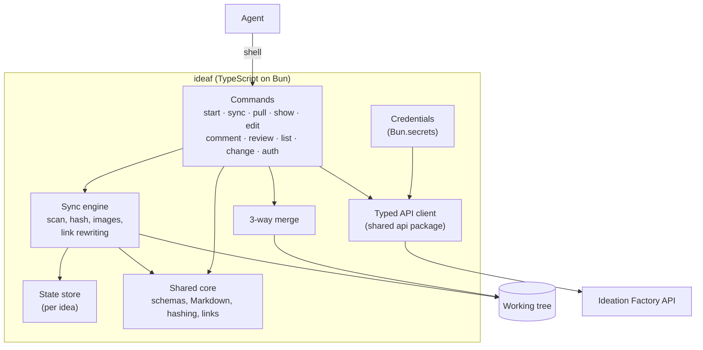
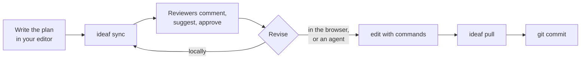
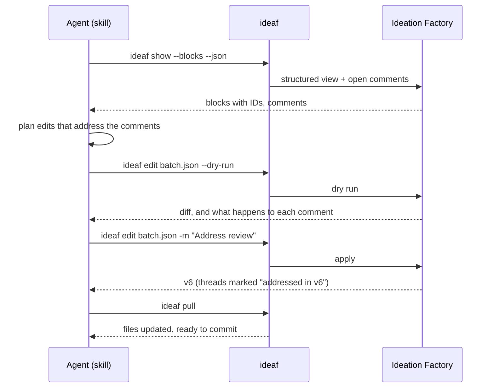

# Ideation Factory MVP: cli and skills

**Status:** proposal for the MVP. See the [overview](architecture.md) first. The full design is in the root `cli.md`.

## Goals

- **One tool for people and agents.** Everything the web app can do to an idea, `ideaf` can do from a terminal or CI, so agents are first-class.
- **Never lose work.** Syncing can't silently overwrite someone else's changes, and pulling merges instead of clobbering.
- **Fit how people already work:** branches, worktrees, several ideas in one repository, or no git at all.
- **Agents' work is always labeled as theirs,** by the token they use.

## Structure

`ideaf` is written in TypeScript and compiled with Bun into a single executable, with `gh`-style subcommands. Agents that don't run a shell use the **hosted MCP server** instead (see [backend](architecture-backend.md#one-set-of-operations-api-and-mcp)). It needs nothing installed, and offers the same operations as the cli.

## Stack

| | Choice | Notes |
|---|---|---|
| Runtime and build | Bun, `bun build --compile` | One executable per platform, cross-compiled for macOS, Linux and Windows (x64 and arm64) |
| Commands | Hand-rolled | A small table of command definitions (name, flags, arguments, help) drives parsing, `--help` and shell completions. `gh`-style subcommands don't need a framework |
| Prompts | `@clack/core` | Unstyled prompt primitives, styled to match the web app. Only used when a person is at a terminal (see below) |
| Credentials | `Bun.secrets` | Tokens go in the OS keychain: macOS Keychain, libsecret on Linux, Windows Credential Manager |
| Shared code | `core` and `api` packages | The same schemas, batch validation, Markdown handling, hashing and link rules as the backend and the web app |

**Built for agents as much as people:**
- **Prompts only appear when a person is there.** That means stdin is a terminal, and neither `--json` nor `--yes` was given. Otherwise a missing value is an error with a clear message, never a wait for input.
- **Every command has `--json` output.**
- **Exit codes are stable,** so a conflict, "pull first" and a validation error can each be told apart.
- **Tokens:** the cli exchanges its long-lived token for a 15-minute signed access token and refreshes it as needed, so the server only checks the long-lived token every 15 minutes (see Auth and access in the [backend](architecture-backend.md)). CI and agents can pass one in `IDEAF_TOKEN`. Where there's no keychain (a headless Linux box without a secret service), the cli says so and falls back to `IDEAF_TOKEN`, or to a token file only its owner can read.

## Commands (MVP)

| Command | What it does |
|---|---|
| `ideaf auth login` / `status` | Sign in, or use a token (`IDEAF_TOKEN` in CI). Tokens are kept in the OS keychain |
| `ideaf start` | Start an idea: title, description, team (or none, which makes it private to you). Optionally create a branch for it off the default branch (`--branch`), checked out in a new worktree (`--worktree`); the files come along as they are |
| `ideaf share` | Show who has access, give or remove view, edit or share access to people, groups or a team's members, or make it public or private. Who is written the same way in and out: `maya` or `@maya`, `group:<handle>`, `team:<handle>`, `everyone` |
| `ideaf move` | Move the idea into, out of, or to another team. Prints who would lose or gain access and asks to confirm; adjustments as flags (`--keep`, `--skip`), `--dry-run`, and `--yes` for agents (without a terminal it won't move without it) |
| `ideaf team …` / `ideaf group …` | List, show and create them; members, adding and removing people, leaving, and joining by request (`join`, `requests`, `approve`, `deny`). `ideaf team settings` changes who can create ideas in a team and what new ideas start with |
| `ideaf list` / `ideaf change` | The ideas in this repository (the active one first), and switching between them. `list` shows yours by default (`--anyone` for everyone's), and `--server`, `--team`, `--owner`, `--status` or `--search` list the ideas you can see on the server instead; ones behind the server or gone are marked. `change` takes an ID, `--title`, or a pick from a list at a terminal, and switches to the idea's branch (never carrying uncommitted changes across; `--here` stays put). If that branch is checked out in another worktree, it makes the idea active there and says where, since it can't change your shell's directory. An idea not in the repository yet is pulled here |
| `ideaf sync [path]` | Upload the idea's Markdown and the images it references. Refuses with "pull first" if the idea has moved on; `--force` overrides |
| `ideaf pull` | Bring the latest version into your files (accepted suggestions, edits made remotely), merging with local edits like git |
| `ideaf show --blocks [--json]` | The structured view: each file's sections and blocks with IDs and text, and the open comments on them |
| `ideaf edit <batch> [--dry-run]` | Edit the idea in place with commands (replace, move, rename a heading, …). One batch makes one version |
| `ideaf comment …` | List, show, add, reply to, resolve and reopen threads, and suggest edits. A comment goes on a file, a section by ID, or a quote: `--quote` takes the text as it reads, and the cli finds it in the file's plain text, so no one counts characters. Suggested edits wait for their API |
| `ideaf review …` | Request reviewers, approve, or request changes |
| `ideaf skills install` | Install the Ideation Factory skills for your agent |

## How work flows

**People** mostly sync and pull:

**Agents** edit remotely, which keeps every comment attached exactly:

## Syncing safely

- **What's uploaded:** the idea's Markdown files in scope (within the deployment's Markdown size limits, checked before uploading), plus images they reference (up to the deployment's image size limit). Never whole folders, and never code, PDFs or video. Links to those are rewritten to the code host (for example GitHub at the idea's branch), and rewritten back to relative links on pull.
- **Base tracking:** every file records the content it was edited from. That's how the server follows comments through an upload, and how it knows when to say "pull first".
- **State per idea:** kept in git's shared directory (`$(git rev-parse --git-common-dir)/ideaf/<idea>.json`). It's shared by every worktree, never committed, and handles several ideas per repository. Outside git, it's `.ideaf/state/` in the synced folder.
- **Repository config** (committed): default team, target branch, paths to exclude, code host URL, a lower image limit.
- **Unsynced local edits block `ideaf edit`,** so remote edits can't strand them.

## Sharing code with the backend

The cli is TypeScript like the backend and the web app, so it shares code directly instead of keeping a copy in step:

- **The `api` package:** the same operation definitions and typed client. Batches are validated locally with the same schemas the server uses, so mistakes show up before anything is sent, with the same messages.
- **The `core` package:** splitting Markdown into blocks and sections, the plain-text form comments are matched in, content hashing, and link rewriting. That lets the cli preview, offline, what an upload would do ("these 3 comments would become outdated").
- **Shared code uses web-standard APIs only** (`fetch`, Web Crypto, `TextEncoder`), so it runs unchanged on the server, in browsers and in the cli. Bun-only APIs (`Bun.secrets`, the file system) stay in the cli package.
- **The server still decides:** edit commands, conflicts, re-anchoring and approval rules run on the server. The cli's local checks are previews and early errors, never the final word.
- **One set of tests** covers the shared code, run once for every place it's used.

Only local work lives in the cli: scanning files and choosing images, the state file, git, the 3-way merge on pull, credentials and prompts.

## Skills

Skills are packaged instructions an agent loads for a task. They're shipped with the cli and installed with `ideaf skills install`. Each uses `ideaf` underneath; an agent without a shell can do the same through the hosted MCP server.

| Skill | What it does |
|---|---|
| **propose** | Turns a plan from the conversation into an idea: start, sync, request reviewers |
| **review** | Reviews an idea: reads the structured view, leaves comments and suggested edits on the exact text, then approves or requests changes, as "a bot for me" or "a bot" |
| **revise** | Addresses open comments: builds a batch of edits, previews it, applies it with "addresses …" notes, replies to the threads, and pulls the result into the repository |
| **status** | What's waiting on me, and a summary of the feedback on my ideas |

## Distribution

- **Builds** for macOS, Linux and Windows, x64 and arm64, from one machine (`bun build --compile --target …`). The executable includes the Bun runtime, so it's larger than a Go binary would be (about 90 MB on Linux x64 in step 4), but there's nothing else to install.
- **Installs** through GitHub releases and Homebrew, and as a container for CI.
- **Self-hosted deployments** point it at their own server with `ideaf auth login --host`.

## After the MVP

- Short-lived credentials for CI and agents through OIDC (workload identity), instead of stored tokens.
- Review batching (one review submission instead of many comments).
- A marked-up pull for fully automated agent workflows.
