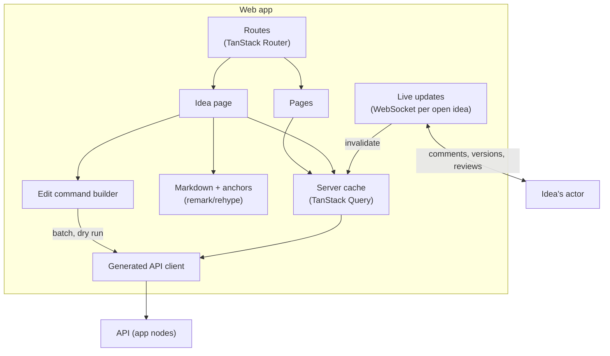
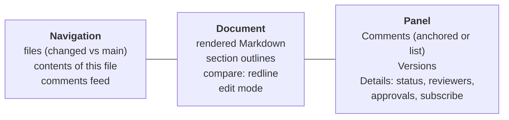

# Ideation Factory MVP: frontend

**Status:** proposal for the MVP. See the [overview](architecture.md) first. The two prototypes in `experiments/` are the reference for how each page looks and behaves.

## Goals

- **A writer-friendly reading experience** for long Markdown, with comments beside the text they're about.
- **Editing that's the same as an agent's.** Every change made in the browser becomes the same edit commands an agent sends, so comments follow it exactly.
- **Fast at real scale**: thousands of people, hundreds of teams, tens of thousands of ideas. Nothing loads everything.
- **Easy for an organization to re-theme**, and usable with a keyboard and a screen reader.

## Stack

| | Choice | Notes |
|---|---|---|
| UI | React | |
| Routing | TanStack Router | Type-safe routes; page state (file, version, compare, filters, page) lives in the URL, so every view is a shareable link |
| Server state | TanStack Query | Caching, cursor-based "next page", and invalidation when a live update arrives |
| Forms | TanStack Form | Settings pages, requirement editor, new team and group setup |
| Build | Vite | The built app is static files, served by the same app nodes as the API |
| Markdown | unified / remark → rehype, sanitized | The syntax tree keeps **source positions**, which is how comments anchored on the Markdown source map onto the rendered page |
| Diffs | jsdiff | Version diffs and the rendered redline (inline word changes, moved blocks) |
| Diagrams | [Pele](https://github.com/obsidianmd/pele) | Draws Mermaid as SVG: synchronous, MIT-licensed, no runtime dependencies. Its CSS variables map onto our theme tokens, so diagrams follow every theme. Drawing is asynchronous, but **preloaded**: most architecture documents have diagrams, so the app fetches Pele (in its own chunk) and the common diagram types at startup, and rarer types on demand. Drawn diagrams are cached by their source. The idea page prototype does all of this already |
| Styling | Plain CSS, design tokens as CSS variables, `rem` only | No pixel values, so themes and zoom work; light, dark and high contrast are built in |
| Components | The `ui` package, shown in [Storybook](https://storybook.js.org) | Pages are built from shared components; see [Components first](#components-first) |
| API client | The shared `api` package: the backend's operation definitions and a typed client | The cli imports the same package and the hosted MCP tools come from the same definitions, so they can't drift apart |

## Structure

## Components first

Pages are put together from shared components, not styled one by one. That keeps the app consistent, and a change to a component reaches every page that uses it.

- **Components live in their own package, `ui`,** together with the design tokens and themes. `web` holds the routes, pages and data loading, and composes `ui` components.
- **Pages contain no CSS:** no stylesheets in `web`, no `style` props, no one-off class names. Layout is components too: the page header, the idea page's three panes, stacks and columns. A CI check fails on any CSS in `web`.
- **Something new is a component first.** When a page needs something no component covers, add it to `ui` (or give an existing one a new prop or variant), with its stories, and then use it. Two pages that need similar UI share one component with variants, not two copies.
- **Components take data; they don't fetch it.** Props in, events out: no TanStack Query or API calls inside `ui`. Pages do the loading. This is what lets the viewer show every state with fixture data.
- **Every component has stories** for each state that matters: empty, loading, error, long text, many items, agent work ("🤖 planbot on behalf of Riley"), and keyboard focus.

### The component viewer

Storybook, run from the `ui` package, is the site that shows every component and story:

- **Themes and text size:** a toolbar switches between light, dark and high contrast, and to larger text, so every component is checked in each.
- **Accessibility:** axe checks run on every story, in the viewer and in CI.
- **Published:** it builds to static files, so contributors, and organizations checking a re-theme, can browse every component without running the app.
- **Why Storybook:** it's the standard viewer for React, MIT-licensed, and builds with Vite like the app, with theme and accessibility add-ons. Stories use the open Component Story Format, which other viewers (Ladle, for one) also read, so we can switch later.

## Pages

| Page | What it's for |
|---|---|
| **Home** | What's waiting on your review, your open ideas, unread updates, and things only you as a maintainer can fix |
| **Notifications** | A GitHub-style inbox, one row per idea with the idea's current state: select, mark read or done, group by date or team |
| **Ideas** | Search every idea you can see; Open and Closed lists with filters |
| **Teams / team page** | Directory, then a team's ideas, members, approval requirements and watch level |
| **Groups / group page** | Directory, then a group's members and where it's used |
| **Settings** for teams and groups | Pages, not popups, with only the tabs your role allows; new teams and groups are set up through the same pages |
| **Your settings** | Profile, sign-in (passkeys), tokens for the cli and agents |
| **Idea page** | Below |

## The idea page

Three panes, each scrolling on its own:

- **Anchored comments:** text comments sit level with their text and move with it; section comments sit inside an outline around their section, nested for subsections.
- **Versions and compare:** view any version, or compare against an earlier one or `main`, as a rendered redline.
- **Diagrams:** Mermaid blocks are drawn (see Pele, above), with their source one click away. The text appears at once, and a diagram not drawn yet holds its place with "Drawing diagram…" until it lands. A diagram that can't be drawn shows its source and the exact error, so nothing is ever hidden.
- **Outdated comments** (their text isn't in this version) show the quote they were on and **View in v2**: the last version where that text existed.
- **The comments feed** is one timeline for the whole idea, like a pull request's conversation tab.
- **Agent work is always labeled:** "🤖 planbot on behalf of Riley", or "🤖 archbot · automated".

## Editing in the browser

Editing builds the same command batches an agent sends (see [backend](architecture-backend.md#editing-with-commands)):

| In the UI | Command |
|---|---|
| Edit a paragraph, list item or table in place | `replace` (scoped to that block) |
| Add text after a block or section | `insert` |
| Drag a section in the contents outline, or to another file | `move` |
| Rename a heading inline | `rename-heading` |
| Rewrite a whole section | `set-section` |
| Delete a block or section | `delete` |
| Accept a suggested edit | its pending `replace` |

Changes collect in a **pending batch**. Before it's applied, a **preview** shows the diff and what happens to each comment (moves with its text, changed, or becomes outdated). Applying makes one new version. If someone else changed the idea meanwhile, the batch is replayed onto the latest version. It only fails if one of its edits no longer applies, and then the preview shows which ones, for the author to redo.

## Data loading and live updates

- **Every list is paged on the server**, 25 at a time, with cursors. People, teams and groups are picked by type-ahead (results capped at about 8), never with a full dropdown.
- **An open idea keeps a live connection** (a WebSocket) to its actor. New comments, versions and review changes arrive live and update the cache, so two reviewers see each other's comments without reloading.
- **Visibility is enforced on the server**, never in the browser. The app only ever receives ideas you're allowed to see.

## Theming and accessibility

- **Tokens:** every color, size, font and radius is a CSS variable on `:root`. An organization re-themes by overriding them, with no rebuild.
- **Themes:** light, dark (Auto follows the system) and high contrast.
- **Type:** Source Serif 4 for headings, Literata for reading, Inter for the interface, JetBrains Mono for code.
- **Accessibility:**
  - every control is reachable by keyboard, and tooltips also open on focus;
  - states are never shown by color alone: icons, text and patterns too;
  - all sizes are in `rem`, so zoom and larger text work.

## After the MVP

- Comments on images.
- An offline-friendly read cache.
- Customizable keyboard shortcuts.
