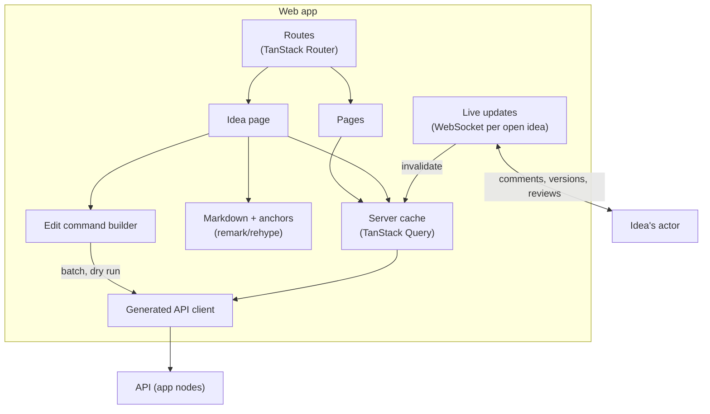
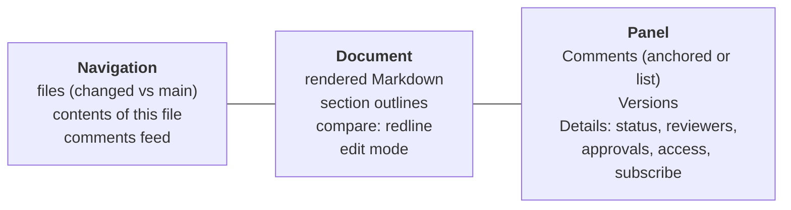

# Ideation Factory MVP: frontend

**Status:** proposal for the MVP. See the [overview](architecture.md) first. The two prototypes in `experiments/` are the reference for how each page looks and behaves.

## Goals

- **A writer-friendly reading experience** for long Markdown, with comments beside the text they're about.
- **Editing that's the same as an agent's.** Every change made in the browser becomes the same edit commands an agent sends, so comments follow it exactly.
- **Fast at real scale**: thousands of people, hundreds of teams, tens of thousands of ideas. Nothing loads everything.
- **Easy for an organization to re-theme**, and usable with a keyboard and a screen reader.

## Stack

| | Choice | Notes |
|---|---|---|
| UI | React | |
| Routing | TanStack Router | Type-safe routes; page state (file, version, compare, filters, page) lives in the URL, so every view is a shareable link. Routes are files, through Router's Vite plugin, and each route's code loads when it's first needed. Not TanStack Start: the API already defines each operation once for the app, the cli and MCP, so server functions would be a second way in, and an app behind sign-in gains little from rendering on the server |
| Server state | TanStack Query | Caching, cursor-based "next page", and invalidation when a live update arrives |
| Live data | [TanStack DB](https://tanstack.com/db) | What changes while a page is open and shows in several places at once: an idea's comments now, reviews and approvals in step 9. A collection's sync owns the idea's live socket, reads once and then applies each event; a write shows at once, waits for its echo on the socket, and goes away if the server refuses it |
| Forms | TanStack Form | Settings pages, requirement editor, new team and group setup |
| Build | Vite | The built app is static files, served by the same app nodes as the API, which is under `/api`; every other path is a page. In development Vite runs behind the server, which passes it the pages' requests, so the browser only ever talks to the server: one origin for the pages, the API, and sign-in's cookies and passkeys |
| Markdown | unified / remark → rehype, sanitized | The syntax tree keeps **source positions**, which is how comments anchored on the Markdown source map onto the rendered page |
| Diffs | jsdiff | Version diffs and the rendered redline (inline word changes, moved blocks) |
| Diagrams | [Pele](https://github.com/obsidianmd/pele) | Draws Mermaid as SVG: synchronous, MIT-licensed, no runtime dependencies. Its CSS variables map onto our theme tokens, so diagrams follow every theme. Drawing is asynchronous, but **preloaded**: most architecture documents have diagrams, so the app fetches Pele (in its own chunk) and the common diagram types at startup, and rarer types on demand. Drawn diagrams are cached by their source. The idea page prototype does all of this already |
| Styling | Plain CSS, design tokens as CSS variables, `rem` only | No pixel values, so themes and zoom work; light, dark and high contrast are built in |
| Components | Building blocks in the `ui` package, and each page's own components beside it in `web`; each package has its own [Storybook](https://storybook.js.org) | Pages are built from components, kept where they're used; see [Components first](#components-first) |
| Interactive parts | [Base UI](https://base-ui.com) | Unstyled and MIT-licensed: the popovers, menus, combobox and dialogs inside `ui` components, for their keyboard, focus and screen-reader handling and their placement. `ui` styles them with its own CSS, through Base UI's data attributes and CSS variables; `web`'s components are built from `ui`'s, never on Base UI directly. Base UI's tooltip is a visual hint that screen readers don't hear, so `Tooltip` is its popover, opening on hover |
| API client | The shared `api` package: the backend's operation definitions and a typed client | The cli imports the same package and the hosted MCP tools come from the same definitions, so they can't drift apart |

## Structure

## Components first

Pages are put together from components, not styled one by one. Each component lives where it's used: a page's own components beside that page, and only what's shared and knows nothing of the product in `ui`. What one page needs stays easy to find and change, and `ui` stays a set of building blocks rather than pieces of the app.

- **Where a component goes:**
  - used by one route: in a `-components/` folder beside that route in `web`, with its CSS and stories (the `-` keeps the router from reading it as routes);
  - used by several routes but about this product (an idea's row in a list, a comment card): in `web`'s `src/components/`;
  - generic, knowing nothing of the product (buttons, selects, tooltips, tabs, the Markdown view, page layouts): in `ui`, with the design tokens and themes.

  A component moves up when a second place needs it, not before. Two places that need similar UI share one component with variants, not two copies.
- **`ui` makes no product decisions.** Options, copy and rules come in as props. A team's watch level, for one, is `ui`'s `Select` in a component beside the team settings page, which knows the levels, what each means, and which ones to highlight.
- **CSS uses the tokens, in either package.** Every color, size and font comes from a token, sizes are in `rem`, and there are no `style` props, so themes, re-theming and zoom work on every page. A component's CSS sits beside it.
- **Components take data; they don't fetch it.** Props in, events out, in both packages: the route does the loading with TanStack Query and passes the results down. This is what lets every component's stories show each state with fixture data.
- **Every component has stories** for each state that matters: empty, loading, error, long text, many items, agent work ("🤖 planbot on behalf of Riley"), and keyboard focus.
- **Links and time come from the app.** A component knows where a link goes, not how the app navigates: it renders `Link`, and the app passes TanStack Router's link in through `LinkProvider`. Relative times ("5h ago") read "now" from `NowProvider`, which the stories fix to one moment so every run reads the same.
- **The document renders core's syntax tree.** `MarkdownView` takes the tree from `core`'s `markdownTree`, the same parse `core` anchors comments on, and renders it to React elements, never an HTML string, so raw HTML in a file is shown as text. Every block carries its source offsets, and comments and changes are given as source ranges.

### The component viewer

Storybook shows every component and story. `ui` and `web` each have their own: `ui`'s shows the building blocks, and `web`'s the app's components. Kept apart, each package's stories build and run as their own CI job, side by side. A combined viewer (Storybook's composition) can come later, if developers want one.

- **Themes and text size:** a toolbar switches between light, dark and high contrast, and to larger text, so every component is checked in each. `web`'s Storybook has the same toolbar.
- **Accessibility:** axe checks run on every story, in the viewer and in CI. In CI, Storybook's Vitest add-on renders each story in headless Chromium, runs its play function and checks it with axe, once per theme (`bun run test:stories` in each package); a violation fails the run.
- **Published:** `ui`'s builds to static files, so contributors, and organizations checking a re-theme, can browse every building block without running the app.
- **Why Storybook:** it's the standard viewer for React, MIT-licensed, and builds with Vite like the app, with theme and accessibility add-ons. Stories use the open Component Story Format, which other viewers (Ladle, for one) also read, so we can switch later.

## Pages

| Page | What it's for |
|---|---|
| **Home** | What's waiting on your review, your open ideas, unread updates, and things only you as a maintainer can fix |
| **Notifications** | A GitHub-style inbox, one row per idea with the idea's current state: select, mark read or done, group by date or team |
| **Ideas** | Search every idea you can see; Open and Closed lists with filters |
| **Teams / team page** | Directory, then a team's ideas, members, approval requirements and watch level |
| **Groups / group page** | Directory, then a group's members and where it's used |
| **Settings** for teams and groups | Pages, not popups, with only the tabs your role allows; new teams and groups are set up through the same pages. A team's settings include its defaults for new ideas and who can create ideas |
| **Sharing** for an idea | Who has access and where it comes from (directly, through a group, as a team member, public), with view, edit or share for each; reached from the idea's Details panel |
| **Move wizard** for an idea | Moving into, out of or between teams: the access now, what the move changes, who loses and who gains access by name, adjustments, then confirm. Nothing changes until confirmed |
| **Your settings** | Profile, sign-in (passkeys), tokens for the cli and agents |
| **Idea page** | Below |

## The idea page

Three panes, each scrolling on its own:

- **Anchored comments:** text comments sit level with their text and move with it; section comments sit inside an outline around their section, nested for subsections.
- **Versions and compare:** view any version (`?v=3`, read only), or compare against an earlier one (`?compare=2`) as a rendered redline. Comparing against `main` comes once the server knows an idea's branch. A new version arriving while the latest is shown moves the page on to it, with a note, since comments go on the latest version only.
- **Diagrams:** Mermaid blocks are drawn (see Pele, above), with their source one click away. The text appears at once, and a diagram not drawn yet holds its place with "Drawing diagram…" until it lands. A diagram that can't be drawn shows its source and the exact error, so nothing is ever hidden.
- **Outdated comments** (their text isn't in this version) show the quote they were on and **View in v2**: the last version where that text existed.
- **The comments feed** is one timeline for the whole idea, like a pull request's conversation tab.
- **Agent work is always labeled:** "🤖 planbot on behalf of Riley", or "🤖 archbot · automated".

## Editing in the browser

Editing builds the same command batches an agent sends (see [backend](architecture-backend.md#editing-with-commands)):

| In the UI | Command |
|---|---|
| Edit a paragraph, list item or table in place | `replace` (scoped to that block) |
| Add text after a block or section | `insert` |
| Drag a section in the contents outline, or to another file | `move` |
| Rename a heading inline | `rename-heading` |
| Rewrite a whole section | `set-section` |
| Delete a block or section | `delete` |
| Accept a suggested edit | its pending `replace` |

Changes collect in a **pending batch**. Before it's applied, a **preview** shows the diff and what happens to each comment (moves with its text, changed, or becomes outdated). Applying makes one new version. If someone else changed the idea meanwhile, the batch is replayed onto the latest version. It only fails if one of its edits no longer applies, and then the preview shows which ones, for the author to redo.

## Data loading and live updates

- **Every list is paged on the server**, 25 at a time, with cursors. People, teams and groups are picked by type-ahead (results capped at about 8), never with a full dropdown.
- **An open idea keeps a live connection** (a WebSocket, relayed by an app node) to its actor. New comments, replies, resolves, versions and review changes arrive live: comments straight into their TanStack DB collection, a new version by reading the idea again. Two reviewers see each other's comments without reloading, and nobody reads the whole list again for each change.
- **Visibility is enforced on the server**, never in the browser. The app only ever receives ideas you're allowed to see.

## Theming and accessibility

- **Tokens:** every color, size, font and radius is a CSS variable on `:root`. An organization re-themes by overriding them, with no rebuild. Light and dark share one list, each color written `light-dark(<light>, <dark>)`, so a theme only sets `color-scheme`; high contrast overrides the colors outright.
- **Themes:** light, dark (Auto follows the system) and high contrast.
- **Type:** Source Serif 4 for headings, Literata for reading, Inter for the interface, JetBrains Mono for code. They're bundled with the app (from Fontsource, under the SIL Open Font License), so a deployment makes no requests to a font service.
- **Accessibility:**
  - every control is reachable by keyboard, and tooltips also open with Enter or Space, and on a tap;
  - states are never shown by color alone: icons, text and patterns too;
  - all sizes are in `rem`, so zoom and larger text work.

## After the MVP

- Comments on images.
- An offline-friendly read cache.
- Customizable keyboard shortcuts.
