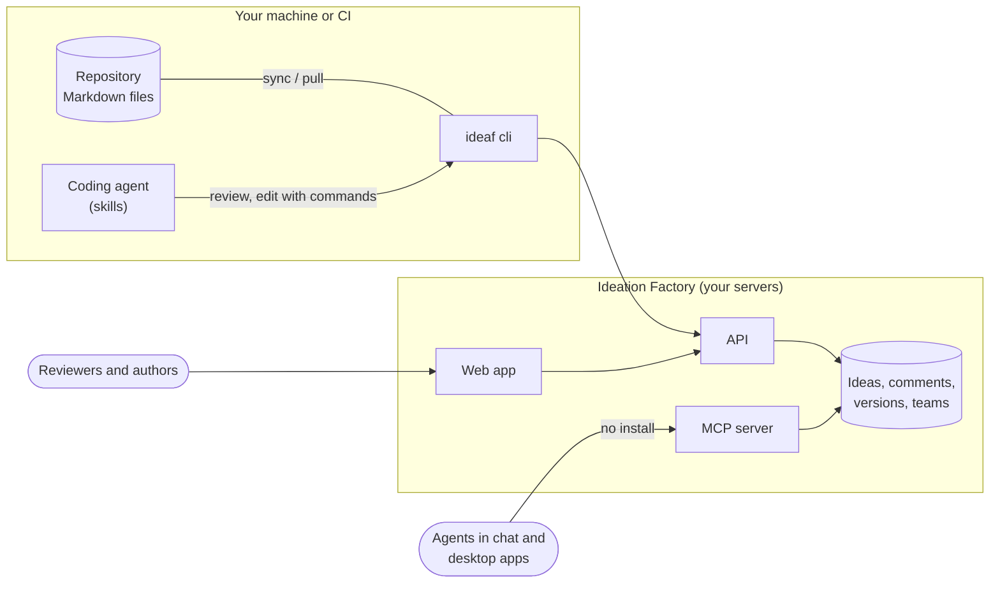
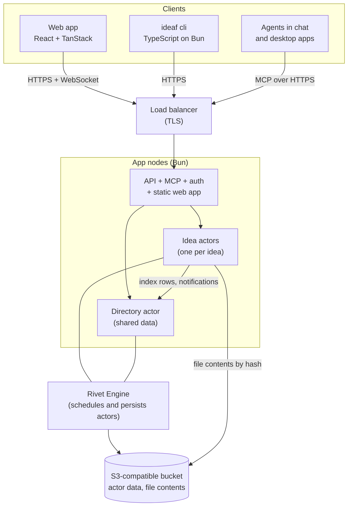

# Ideation Factory: MVP architecture

**Status:** proposal for the minimum viable product. Details live in [frontend](architecture-frontend.md), [backend](architecture-backend.md) and [cli and skills](architecture-cli.md). The full design is in the root `idea.md`, `architecture.md` and `cli.md`.

## The problem

Agents now write a day's worth of code before lunch, so the expensive mistakes have moved upstream: into the design, the architecture and the plan. Those plans are Markdown, written by people and agents together, and today they're reviewed in chat threads, PR comments on files that keep changing, or not at all.

## What the MVP does

Ideation Factory is an open-source, self-hostable place where a team reviews those plans before code gets written:

1. **An idea** is one or more Markdown files (a plan, a design, an ADR). It's synced from a repository, or anywhere else, with the `ideaf` cli.
2. **People and agents review it.** They comment on a file, a section or a sentence, suggest edits, and approve or request changes against the team's approval rules.
3. **The author and their agents revise it in place with edit commands:** "replace this sentence", "move this section", "rename this heading". Because every edit says exactly what it does, **comments stay attached to the right text** through round after round of restructuring.
4. **The result is pulled back into the repository** and committed like any other change.

Step 3 is what nothing else does well. Tools that diff a new copy can only guess where a comment went, and GitHub gives up and marks it "outdated". Here the edit itself carries the answer, and that works the same for a person in the browser and an agent in a terminal.



## Who it's for

- **Engineers** who want a second opinion on a plan before an agent builds it.
- **Reviewers and leads** who need one inbox for "what's waiting on me", across repositories.
- **Agents** that review plans, or revise them from feedback, through the cli or MCP. Their work is always labeled as theirs: "🤖 planbot on behalf of Riley".
- **Organizations** that run it themselves, **on infrastructure they already have**. It's open source, and needs no particular cloud: containers, a small coordinator, and an S3-compatible bucket.

## High-level design



Five decisions carry the design:

1. **One actor per idea.** Every idea is a [Rivet](https://github.com/rivet-dev/rivet) actor with its own SQLite database. Every write to an idea (comments, edit batches, accepted suggestions and approvals) goes into that actor's queue and is applied one at a time. Reads run alongside, in parallel. No locks, no lost updates, and live updates for free. It scales with the number of ideas, not the size of the biggest team.
2. **Content-addressed storage.** A version is a small list of paths and content hashes, and each distinct file is stored once, in the bucket. Storage grows with changes, not with versions × files, and no git server is needed, so an idea doesn't even have to come from git.
3. **One edit framework for everyone.** The web app, the cli, the MCP server and "accept suggestion" all send the same edit commands, through the same checks. Concurrent edits behave like pull requests: they merge if they still apply, and conflict if they don't.
4. **One set of operations, hosted.** Each operation is defined once in the backend and exposed both as the HTTP API and as a **hosted MCP server**, so agents in chat and desktop apps need nothing installed. The web app and the cli import the same typed definitions, so they can't drift. An agent can do anything a person can, and nothing more than its token allows.
5. **Ordinary infrastructure, no database server.** It runs as containers on VMs or Kubernetes. Everything durable ends up in one S3-compatible bucket (AWS S3, Google Cloud Storage, Azure, Cloudflare R2, or SeaweedFS or RustFS on premises; it must support conditional writes), so there's no Postgres to run and no cloud vendor required.

## Tech stack

| Layer | Choice | Why |
|---|---|---|
| Web app | React, TanStack Router and Query, Vite | Type-safe routes with state in the URL (shareable links), solid server caching and pagination; the prototypes already use it |
| Styling | Plain CSS with CSS variables, sizes in `rem` | Light, dark and high-contrast themes out of the box; an organization re-themes by overriding variables |
| Server | TypeScript on Bun, with [RivetKit](https://github.com/rivet-dev/rivet) actors | One runtime for the server and the cli; actors give one consistent home per idea, with SQLite, live connections and scheduling built in |
| State | Rivet actors: one per idea, plus a directory actor for shared data, each with its own SQLite | Strong consistency per idea; the Rivet Engine (3.0, in preview) persists actors to the bucket and moves them if a node fails |
| Files | Any S3-compatible bucket | Cheap, deduplicated, and something every company already has |
| Hosting | One VM to start; three or more for production (Docker Compose or Kubernetes) | Standard containers behind a load balancer. Rivet's hosted cloud is optional, never required |
| CLI | TypeScript, compiled with Bun into a single executable | Easy to install everywhere, including CI; `gh`-style subcommands; shares the core packages with the backend and the web app |
| Agents | A hosted MCP server (part of the backend), the cli, and skills | Works with whatever agent a team already uses; nothing to install for MCP |
| Sign-in | Email code and passkeys, or the organization's single sign-on (SAML or OIDC), with SCIM; no passwords ([Better Auth](https://better-auth.com)) | Simple and phishing-resistant; most companies will use their own identity provider |

## One codebase

Everything is TypeScript, in one repository, so the code that defines what an edit or an anchor means exists exactly once:

```
packages/
  core/     schemas, edit commands, Markdown blocks, anchoring, hashing, links
            (web-standard APIs only, so it runs on servers, in browsers and in Bun)
  api/      each operation defined once → HTTP routes, MCP tools, a typed client
  server/   the Bun app: HTTP and MCP, auth, the idea and directory actors,
            and small interfaces for files (bucket) and email (SMTP or an email API)
  ui/       the building blocks: React components, design tokens and themes
  web/      the React app: routes, pages, their components and data loading
  cli/      ideaf on Bun: files, git, state, merging, credentials, prompts
```

## MVP scope

**In the MVP:**

- Ideas with several Markdown files (sparse, nested), versions, and diffs against earlier versions and against the target branch.
- **Editing with commands** in the web app, the cli and MCP: batches, dry runs, pull-request-style conflicts.
- **A hosted MCP server**, signed into with OAuth, for agents that don't run a shell.
- Uploading an edited copy, with comments followed through the diff (exact matching only, never a guess).
- Comments on a file, section or text; replies; resolving; suggested edits; outdated comments linking to the version where they applied.
- Reviews: requesting people or groups, approve or request changes, and team approval requirements (minimum approvals, group rules, all discussions resolved).
- **Access per idea, like a shared document:** view, edit and share, given to people, groups, a team's members or everyone; reviewers are viewers. Ideas outside a team start private; ideas in a team start with the team's defaults.
- Teams and groups with admin, maintainer and member roles; teams decide who can create ideas in them; teams and groups are invite only. Moving an idea between teams goes through a move wizard that shows, and lets you adjust, how access changes.
- A GitHub-style notification inbox, with watch levels per team.
- Search across ideas, teams and groups.
- Images in Markdown; other files link back to the code host.
- Tokens with a purpose ("me", "a bot for me", "a bot"), so agent work is always attributed.
- Sign-in with an email code or a passkey.
- **Self-hosting** on one VM or a three-node cluster, with Docker Compose, plus a Kubernetes example.

**After the MVP:** a Site admin page for single sign-on (it's configuration in the MVP), other site-admin tools, site admin tokens, review batching, email notifications, fuzzy comment re-anchoring, and per-deployment settings in the UI (they're install-time configuration in the MVP).

## Already validated

Two front-end prototypes (in `experiments/`) cover the idea page (comments anchored to sections and text, versions, compare, the comments feed) and the rest of the site (home, inbox, teams, groups, roles, settings, site admin, sign-up). They're running with realistic data: 3,000 people, 240 teams and 6,000 ideas. `experiments/demo` publishes both behind a password for anyone who wants to click through.

What still needs proving before the build commits is in two spikes: [Rivet](spike-rivet.md) (the platform) and [Better Auth](spike-better-auth.md) (sign-in, tokens and MCP).
