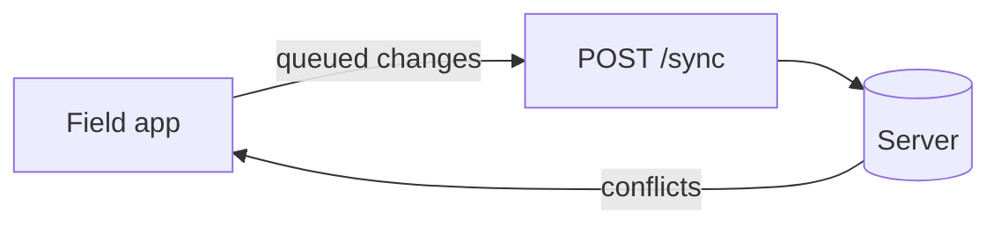

# Offline-first sync for the field app

Field technicians lose signal in basements and plant rooms, and today the app **stops working** until it's back. This proposes keeping a local copy of their work and syncing it when they reconnect.

## Proposal

The app keeps every change in a local queue and replays it against the server, oldest first. See [the architecture overview](architecture/overview.md) and [Conflicts](#conflicts).

### Sync endpoint

One endpoint takes a batch of changes with the version each was based on:

```ts
POST /sync
{ "base": 41, "changes": [{ "op": "update", "id": "job-7", "fields": { "status": "done" } }] }
```

### Conflicts

When two people change the same field, the server keeps both and asks the second person to choose. ~~Last write wins~~ is what we do today, and it loses work.

| Case              |    What happens    |       Who decides |
| :---------------- | :----------------: | ----------------: |
| Same field        |     Both kept      | The second person |
| Different fields  |       Merged       |            Nobody |
| Deleted meanwhile | Restored as a copy | The second person |

> We tried last-write-wins in the pilot. Three technicians lost a morning's notes each.

## Rollout

1. Ship behind a flag to the pilot team.
2. Turn it on for everyone once conflicts stay under 1%.
   - Watch the conflict dashboard daily.
   - Keep the old path for a month.

- [x] Design review
- [ ] Load test with 5,000 queued changes

The sync flow is in the diagram below.[^diagram]




<details><summary>Raw HTML is shown, not run</summary><script>alert(1)</script></details>

---

[^diagram]: Drawn from the whiteboard session in March.
